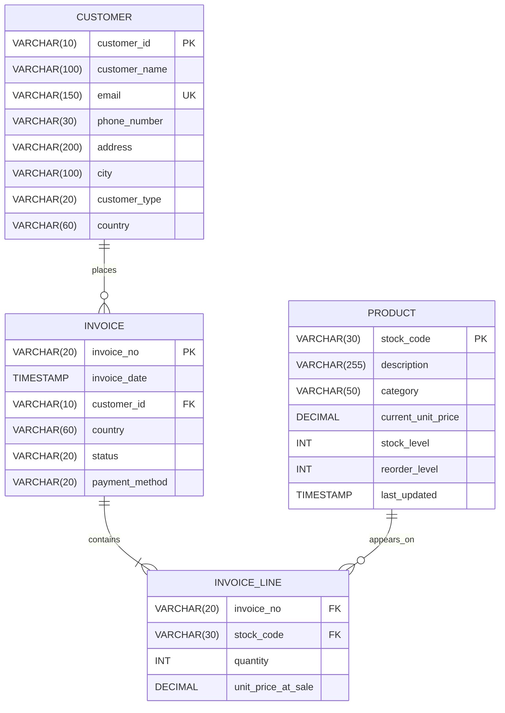

# KoDes Retail Relational Architecture and Entity Relationship Diagram

This diagram reflects the project model after applying the lecturer's design directions: inventory attributes are part of `product`, and `invoice_line` has no primary key. The remaining entities, keys, and foreign keys correspond to `sql/schema.sql`.

## Entity Relationship Diagram

## Relationships

| Relationship | Cardinality | Rule |
|:---|:---:|:---|
| `customer` to `invoice` | 1 to 0..N | Each invoice references exactly one customer. A customer may have no invoices or many invoices. |
| `invoice` to `invoice_line` | 1 to 1..N in the business model | Each detail row references one invoice; an invoice consists of one or more detail rows. The SQL foreign key enforces the child-to-parent reference, but does not enforce a minimum number of detail rows per invoice. |
| `product` to `invoice_line` | 1 to 0..N | Each detail row references one product. A product may appear on zero or many detail rows. |

## Primary and Foreign Keys

| Table | Primary key | Foreign keys |
|:---|:---|:---|
| `customer` | `customer_id` | — |
| `product` | `stock_code` | — |
| `invoice` | `invoice_no` | `customer_id` references `customer(customer_id)` |
| `invoice_line` | None, per lecturer direction | `invoice_no` references `invoice(invoice_no)`; `stock_code` references `product(stock_code)` |

`invoice_line` is the associative table between `invoice` and `product`. Per the lecturer's direction it has no primary key, including no surrogate `line_id`. Because `(invoice_no, stock_code)` can repeat in the source data, neither FK alone nor that pair uniquely identifies every detail row. The schema therefore enforces the two foreign keys but does not enforce uniqueness of detail rows.

## Data Dictionary

### `customer`

| Column | Type | Constraints | Meaning |
|:---|:---|:---|:---|
| `customer_id` | `VARCHAR(10)` | PK, NOT NULL | Source customer ID; `0` represents the unified guest. |
| `customer_name` | `VARCHAR(100)` | NOT NULL | Synthetic display name. |
| `email` | `VARCHAR(150)` | NOT NULL, UNIQUE | Synthetic `example.com` email. |
| `phone_number` | `VARCHAR(30)` | NOT NULL | Synthetic phone number. |
| `address` | `VARCHAR(200)` | NOT NULL | Synthetic street address. |
| `city` | `VARCHAR(100)` | NOT NULL | Synthetic city assignment. |
| `customer_type` | `VARCHAR(20)` | NOT NULL, CHECK | `Registered` or `Guest`. |
| `country` | `VARCHAR(60)` | NOT NULL | Modal transaction country; the guest profile uses a label. |

### `product`

| Column | Type | Constraints | Meaning |
|:---|:---|:---|:---|
| `stock_code` | `VARCHAR(30)` | PK, NOT NULL | Normalized SKU. |
| `description` | `VARCHAR(255)` | NOT NULL | Canonical description for the SKU. |
| `category` | `VARCHAR(50)` | NOT NULL | Category assigned by description rules. |
| `current_unit_price` | `DECIMAL(10,2)` | NOT NULL, CHECK >= 0 | Product reference price. In the processed dataset it is a median positive historical price proxy, not a verified live catalog price. |
| `stock_level` | `INT` | NOT NULL, DEFAULT 1000 | Assumed opening stock quantity. |
| `reorder_level` | `INT` | NOT NULL, CHECK >= 0 | Demand-derived replenishment threshold. |
| `last_updated` | `TIMESTAMP` | NOT NULL, DEFAULT CURRENT_TIMESTAMP | Inventory update timestamp. |

### `invoice`

| Column | Type | Constraints | Meaning |
|:---|:---|:---|:---|
| `invoice_no` | `VARCHAR(20)` | PK, NOT NULL | Source invoice identifier. |
| `invoice_date` | `TIMESTAMP` | NOT NULL | Earliest source timestamp per invoice. |
| `customer_id` | `VARCHAR(10)` | FK, NOT NULL | References `customer(customer_id)`. |
| `country` | `VARCHAR(60)` | NOT NULL | Country for this transaction. |
| `status` | `VARCHAR(20)` | NOT NULL, CHECK | `Completed`, `Cancelled`, or `Loss`. |
| `payment_method` | `VARCHAR(20)` | NOT NULL, CHECK | Synthetic method; `N/A` for loss invoices. |

### `invoice_line`

| Column | Type | Constraints | Meaning |
|:---|:---|:---|:---|
| `invoice_no` | `VARCHAR(20)` | FK, NOT NULL | References `invoice(invoice_no)`. |
| `stock_code` | `VARCHAR(30)` | FK, NOT NULL | References `product(stock_code)`. |
| `quantity` | `INT` | NOT NULL | Absolute quantity; direction is inferred from invoice status. |
| `unit_price_at_sale` | `DECIMAL(10,2)` | NOT NULL, CHECK >= 0 | Actual unit price charged on this transaction, including discounts. It is recorded independently of `product.current_unit_price`. |

The schema follows the lecturer's no-PK direction for this table. As a consequence, the database cannot distinguish two fully identical invoice-line rows or target one particular duplicate row for update/delete.

## Normalization Notes

- Customer, invoice, product, and invoice-line facts are separated by their business roles.
- Inventory attributes are stored with `product`, avoiding a separate one-to-one entity.
- `unit_price_at_sale` records the amount actually charged, so a discounted transaction amount remains unchanged in history. The schema does not store the list price at the transaction time, so it cannot calculate the discount amount after the product reference price changes.
- The associative `invoice_line` table has no key because of the lecturer's requirement. This is a stated design exception: SQL can contain duplicate rows, so strict relational set uniqueness is not enforced for invoice details.
- The RFM reporting view derives customer aggregates instead of storing them in `customer`.
