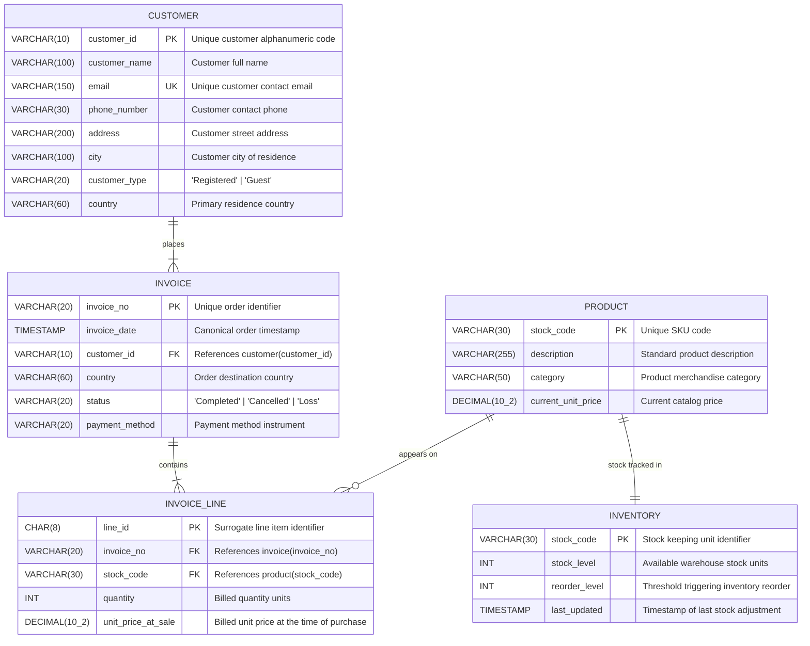

# KoDes Retail Relational Architecture and Entity Relationship Diagram

This document outlines the relational architecture designed for KoDes Retail, transforming unnormalized transactional flat-file records into a normalized relational database.

The design eliminates update, insertion, and deletion anomalies, enforces referential integrity across all entities, and separates live catalog metadata from immutable transaction line items.

---

## 1. Relational Entity Relationship Diagram

---

## 2. Cardinalities and Relationships

| Relationship | Cardinality | Parent Table | Child Table | Foreign Key | Modality |
|:---|:---:|:---|:---|:---|:---|
| places | 1 : N | customer | invoice | customer_id | Mandatory One to Mandatory Many (`||` to `\|{`) |
| contains | 1 : N | invoice | invoice_line | invoice_no | Mandatory One to Mandatory Many (`||` to `\|{`) |
| appears on | 1 : N | product | invoice_line | stock_code | Mandatory One to Optional Many (`||` to `o{`) |
| stock tracked in | 1 : 1 | product | inventory | stock_code | Mandatory One to Mandatory One (`||` to `||`) |

---

## 3. Data Dictionary

### Table: customer
Master directory storing individual registered customers and guest checkouts.

| Column | Type | Constraints | Description |
|:---|:---|:---|:---|
| customer_id | VARCHAR(10) | PRIMARY KEY | Unique customer identifier. |
| customer_name | VARCHAR(100) | NOT NULL | Customer full legal/display name. |
| email | VARCHAR(150) | NOT NULL, UNIQUE | Unique account email address. |
| phone_number | VARCHAR(30) | NULL | Customer contact telephone number. |
| address | VARCHAR(200) | NOT NULL | Customer delivery address street line. |
| city | VARCHAR(100) | NOT NULL | Customer domicile city. |
| customer_type | VARCHAR(20) | NOT NULL | Membership category ('Registered' or 'Guest'). |
| country | VARCHAR(60) | NOT NULL | Customer primary country of residence. |

### Table: invoice
Order header capturing transaction-level metadata and lifecycle states.

| Column | Type | Constraints | Description |
|:---|:---|:---|:---|
| invoice_no | VARCHAR(20) | PRIMARY KEY | Unique order alphanumeric identifier. Orders with prefix 'C' represent cancellations. |
| invoice_date | TIMESTAMP | NOT NULL | Canonical invoice timestamp. |
| customer_id | VARCHAR(10) | NOT NULL, FK REFERENCES customer(customer_id) | Account that placed the order. |
| country | VARCHAR(60) | NOT NULL | Transaction shipping destination country. |
| status | VARCHAR(20) | NOT NULL | Order lifecycle status ('Completed', 'Cancelled', 'Loss'). |
| payment_method | VARCHAR(20) | NOT NULL | Payment instrument ('Credit Card', 'PayPal', 'Bank Transfer', etc.). |

### Table: product
Catalog master table storing active merchandise details.

| Column | Type | Constraints | Description |
|:---|:---|:---|:---|
| stock_code | VARCHAR(30) | PRIMARY KEY | Stock keeping unit (SKU) identifying the merchandise item. |
| description | VARCHAR(255) | NOT NULL | Canonical catalog product description. |
| category | VARCHAR(50) | NOT NULL | Merchandise department or grouping. |
| current_unit_price | DECIMAL(10,2) | NOT NULL, DEFAULT 0.00 | Current list price of the product. |

### Table: inventory
Warehouse stock ledger maintaining real-time quantity on hand.

| Column | Type | Constraints | Description |
|:---|:---|:---|:---|
| stock_code | VARCHAR(30) | PRIMARY KEY | Stock keeping unit identifier. |
| stock_level | INT | NOT NULL, DEFAULT 1000 | Current quantity available in the warehouse. |
| reorder_level | INT | NOT NULL, DEFAULT 100 | Minimum stock threshold before replenishment order is triggered. |
| last_updated | TIMESTAMP | NOT NULL, DEFAULT CURRENT_TIMESTAMP | Timestamp recording the most recent inventory modification. |

### Table: invoice_line
Atomic transaction items capturing historical sales.

| Column | Type | Constraints | Description |
|:---|:---|:---|:---|
| line_id | CHAR(8) | PRIMARY KEY | Fixed 8-character surrogate identifier for each transaction line item. |
| invoice_no | VARCHAR(20) | NOT NULL, FK REFERENCES invoice(invoice_no) | Reference to parent invoice header. |
| stock_code | VARCHAR(30) | NOT NULL, FK REFERENCES product(stock_code) | Reference to catalog product purchased. |
| quantity | INT | NOT NULL | Units purchased (positive values for sales, negative for adjustments). |
| unit_price_at_sale | DECIMAL(10,2) | NOT NULL, DEFAULT 0.00 | Actual unit price billed at the time of sale. |
