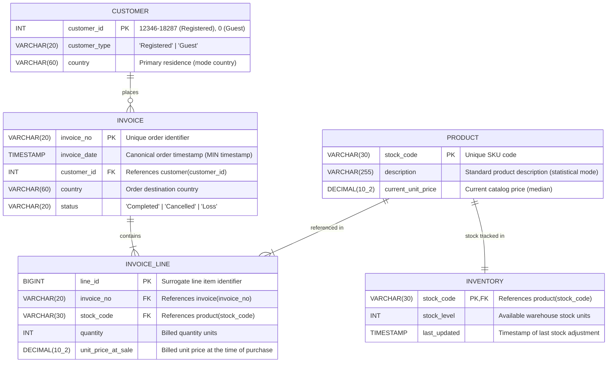

# KoDes Retail Relational Architecture and 3NF Entity Relationship Diagram

This document outlines the relational architecture designed for KoDes Retail, transforming unnormalized transactional flat-file records into a Third Normal Form (3NF) relational database.

The design eliminates update, insertion, and deletion anomalies, enforces strict ACID referential integrity across all entities, and separates live catalog metadata from immutable transaction line items.

---

## 1. Relational Entity Relationship Diagram

---

## 2. Cardinalities and Referential Actions

| Relationship | Cardinality | Parent Table | Child Table | Foreign Key | Referential Action |
|:---|:---:|:---|:---|:---|:---|
| places | 1 : N | customer | invoice | customer_id | ON UPDATE CASCADE, ON DELETE RESTRICT |
| contains | 1 : N | invoice | invoice_line | invoice_no | ON UPDATE CASCADE, ON DELETE CASCADE |
| referenced in | 1 : N | product | invoice_line | stock_code | ON UPDATE CASCADE, ON DELETE RESTRICT |
| stock tracked in | 1 : 1 | product | inventory | stock_code | ON UPDATE CASCADE, ON DELETE CASCADE |

### Referential Action Rationale:
* Master entity preservation: Both customer and product use ON DELETE RESTRICT to prevent accidental cascading deletions of master records that have historical transaction dependencies.
* Atomic transaction cleanup: The invoice to invoice_line relationship uses ON DELETE CASCADE to ensure that deleting an order header purges its associated line items atomically.
* Inventory tracking synchronization: The product to inventory relationship uses ON DELETE CASCADE so removing a catalog SKU removes its warehouse tracking row concurrently.

---

## 3. Data Dictionary

### Table: customer
Master directory storing individual registered customers and guest checkouts.

| Column | Type | Constraints | Description |
|:---|:---|:---|:---|
| customer_id | INT | PRIMARY KEY | Unique customer identifier. Registered users use IDs 12346 to 18287; unauthenticated UK transactions are mapped to guest ID 0. |
| customer_type | VARCHAR(20) | NOT NULL, CHECK (customer_type IN ('Registered', 'Guest')) | Membership category of the account. |
| country | VARCHAR(60) | NOT NULL | Customer primary country of residence, derived from statistical mode across purchase history. |

3NF Note: Lifetime customer spend, first order date, and last order date are deliberately excluded from physical storage. Storing them here would introduce transitive derivation anomalies; they are instead computed dynamically through view_customer_rfm.

### Table: invoice
Order header capturing transaction-level metadata and lifecycle states.

| Column | Type | Constraints | Description |
|:---|:---|:---|:---|
| invoice_no | VARCHAR(20) | PRIMARY KEY | Unique order alphanumeric identifier. Orders with prefix 'C' represent customer cancellations. |
| invoice_date | TIMESTAMP | NOT NULL | Canonical invoice timestamp, resolved using the minimum recorded timestamp for multi-line transactions. |
| customer_id | INT | NOT NULL, FK REFERENCES customer(customer_id) | Account that placed the order. Guaranteed NOT NULL via guest account mapping. |
| country | VARCHAR(60) | NOT NULL | Transaction shipping destination country. |
| status | VARCHAR(20) | NOT NULL, CHECK (status IN ('Completed', 'Cancelled', 'Loss')) | Order lifecycle status assigned via invoice-level majority mode. |

### Table: product
Catalog master table storing active merchandise details.

| Column | Type | Constraints | Description |
|:---|:---|:---|:---|
| stock_code | VARCHAR(30) | PRIMARY KEY | Stock keeping unit (SKU) identifying the item. |
| description | VARCHAR(255) | NOT NULL | Canonical catalog product description, normalized via statistical mode. |
| current_unit_price | DECIMAL(10,2) | NOT NULL, DEFAULT 0.00, CHECK (current_unit_price >= 0.00) | Current list price of the product, initialized to the median of historical positive unit prices. |

### Table: inventory
Warehouse stock ledger maintaining real-time quantity on hand.

| Column | Type | Constraints | Description |
|:---|:---|:---|:---|
| stock_code | VARCHAR(30) | PRIMARY KEY, FK REFERENCES product(stock_code) | Stock keeping unit referencing product. |
| stock_level | INT | NOT NULL, DEFAULT 1000 | Current quantity available in the warehouse. |
| last_updated | TIMESTAMP | NOT NULL, DEFAULT CURRENT_TIMESTAMP | Timestamp recording the most recent inventory modification. |

### Table: invoice_line
Atomic transaction items capturing historical sales.

| Column | Type | Constraints | Description |
|:---|:---|:---|:---|
| line_id | BIGINT | PRIMARY KEY | Surrogate identifier for each transaction line item. |
| invoice_no | VARCHAR(20) | NOT NULL, FK REFERENCES invoice(invoice_no) | Reference to parent invoice header. |
| stock_code | VARCHAR(30) | NOT NULL, FK REFERENCES product(stock_code) | Reference to catalog product purchased. |
| quantity | INT | NOT NULL | Units purchased (positive values for Completed and Cancelled sales; negative values for warehouse losses). |
| unit_price_at_sale | DECIMAL(10,2) | NOT NULL, DEFAULT 0.00, CHECK (unit_price_at_sale >= 0.00) | Actual unit price billed at the time of sale. Preserved independently of catalog price changes. |

---

## 4. Normalization Proof

### First Normal Form (1NF)
1. All attributes contain atomic scalar values with no multi-valued sets, arrays, or composite fields.
2. Every table possesses an explicit primary key ensuring unique row addressability.
3. Repeating column groups (such as multiple product columns across a single invoice row) were eliminated by separating transaction details into invoice_line.

### Second Normal Form (2NF)
1. The schema satisfies 1NF.
2. In all tables with composite business keys, partial dependencies are eliminated.
   * In invoice_line, attributes quantity and unit_price_at_sale depend entirely on line_id.
   * Product descriptive attributes (description, current_unit_price) depend solely on stock_code, preventing product details from repeating on line items.

### Third Normal Form (3NF)
1. The schema satisfies 2NF.
2. All non-key attributes are directly functionally dependent on candidate keys with zero transitive dependencies (X -> Y -> Z):
   * Historical vs catalog price decoupling: unit_price_at_sale in invoice_line preserves the immutable financial transaction at the moment of sale. Changes to current_unit_price in product do not alter historical records.
   * Derived attributes: Aggregated customer metrics (recency, frequency, monetary value) are not materialized in customer, eliminating update anomalies caused by redundant calculations.
   * Destination country: Recording country on invoice ensures shipping destination is captured independently from customer domicile shifts.
