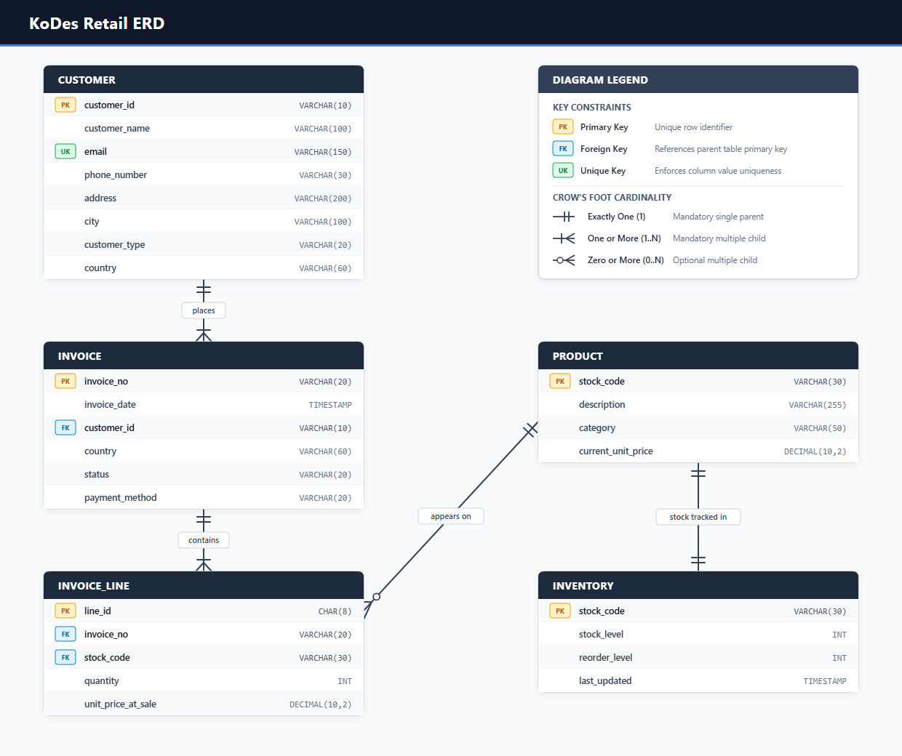

# KoDes Retail Phase 1 Master Documentation

## Purpose and Scope

This document consolidates the original Phase 1 findings with the current relational model and processed dataset. The current ERD and `sql/schema.sql` are the design references: they include operational attributes added during implementation, such as customer contact placeholders, inventory levels, invoice status and payment method, and product category and catalog-price proxy.

The eight source fields are `Invoice`, `StockCode`, `Description`, `Quantity`, `InvoiceDate`, `Price`, `Customer ID`, and `Country`. The additional fields in the relational tables support the assignment's database and reporting requirements; some are derived or synthetic and are identified below.

## Contents

- [A. Source Data Quality Findings](#a-source-data-quality-findings)
- [B. Current Cleaning and Alteration Log](#b-current-cleaning-and-alteration-log)
- [C. Current Relational Model](#c-current-relational-model)
- [D. Normalization Notes](#d-normalization-notes)
- [E. Processed Query Benchmarks](#e-processed-query-benchmarks)
- [F. Implementation Notes and Follow-up](#f-implementation-notes-and-follow-up)

## A. Source Data Quality Findings

The Phase 1 source analysis records **1,067,371 source rows** from 1 December 2009 through 9 December 2011. The earlier single-sheet Excel export contained 1,048,575 data rows and was truncated at Excel's worksheet row limit. The current repository has the complete export after exact duplicates were removed: `data/raw/online_retail_data_dedup.csv` has **1,033,036 data rows**.

| Source field | Finding from profiling | Handling in the current pipeline |
|:---|:---|:---|
| `Invoice` | Over 19,260 rows have a `C` cancellation/credit-note prefix; six `A`-prefixed rows were bad-debt adjustments. Eighty-three invoices had multiple timestamps. | Invoice dates are standardized to the earliest timestamp. `C` prefixes inform cancellation classification; the current admin-SKU filter is documented in Section B. |
| `StockCode` | Historical profiling found 5,980 administrative/non-merchandise rows under the original code list. `M`/`m` differ by case. More than 87,752 rows share an `(Invoice, StockCode)` pair, so that pair is not a unique line key. | Codes are trimmed and uppercased. A generated `line_id` is the invoice-line primary key. Current exclusions use exact codes plus the `GIFT_0001_` prefix; `DCGS*` merchandise is retained. |
| `Description` | 4,275 descriptions were blank; 1,214 SKUs had multiple descriptions. Profiling also found extensive whitespace/case variation and free-text staff notes. Words such as "check", "carriage", and "dotcom" can occur in genuine product names. | Descriptions are trimmed and uppercased; a modal catalog description is assigned per SKU. Blank-description rows are excluded. Price-note logic compares the row with the chosen catalog description rather than using broad keyword matching. |
| `Quantity` | About 19,260 negative rows are cancellation lines; about 3,437 negative non-cancellation rows are loss/write-off records. One cancellation invoice had positive quantity. An extreme quantity of 74,215 and its negative counterpart were reported. | Status is classified before quantities are stored as absolute values. The final invoice header status is the modal line status. |
| `Price` | Profiling reported 6,166 zero-price rows, five negative-price rows associated with StockCode `B`/bad-debt adjustments, and 234 rows above 1,000 (maximum 38,970). | Recoverable zero-price lines receive the mean positive price for the same SKU. Unrecoverable positive-quantity zero-price lines remain zero and are marked as loss notes. The current `B` administrative-code rule excludes the negative-price adjustment rows; the processed file has no negative line prices. |
| `Customer ID` | 235,151 IDs were blank (about 22.8%); approximately 98.7% of these rows were UK transactions. IDs can be represented as floating-point text. Thirteen registered customers appeared with more than one country. | IDs are normalized to integers represented as strings. Anonymous UK rows use guest ID `0`; non-UK blank-ID rows are excluded. A registered customer's country is set to its modal transaction country. |
| `Country` | Profiling identified 756 `Unspecified` and 61 `European Community` entries. Invoice destinations can differ from a customer's most frequent country. | Invoice country retains the transaction's country. Customer country is a modal profile value; these fields have different meanings. |
| File level | The complete source had 34,335 exact duplicate rows and exceeded a single Excel worksheet's row limit. | Exact duplicates were removed before the current deduplicated input file was produced. The ETL performs a duplicate check again, which finds none in that input. |

### Source findings versus current exclusions

The original Phase 1 profiling listed 21 administrative/non-merchandise code families, including `DCGS*`. The current implementation explicitly treats `DCGS*` as genuine merchandise and retains it. This is a deliberate rule change in the current script; the older code-family list should not be presented as the current exclusion list.

## B. Current Cleaning and Alteration Log

The current run starts with the deduplicated CSV, not the 1,067,371-row pre-dedup source. This distinction makes the deletion budget reconcile:

| Stage | Rows | Calculation or source |
|:---|---:|:---|
| Complete pre-dedup source | 1,067,371 | Source count recorded in Phase 1 |
| Exact duplicate rows removed upstream | 34,335 | 1,067,371 minus 1,033,036 |
| Current input to `imputer.py` | 1,033,036 | `data/raw/online_retail_data_dedup.csv` |
| Current pipeline exclusion union | 12,953 | 1,033,036 minus 1,020,083 processed lines |
| Processed invoice lines | 1,020,083 | `data/processed/invoice_lines.csv` |
| Total removed from complete source | 47,288 (4.43%) | 34,335 plus 12,953; within the 10% ceiling |

The current exclusion union removes rows whose SKU is in the script's exact admin-code set or starts with `GIFT_0001_`, whose description is blank, or whose customer ID is blank outside the United Kingdom. The union mask prevents counting a row twice when more than one condition applies.

### Correction and derivation rules

1. **Invoice timestamp:** each invoice uses `MIN(InvoiceDate)` to create one canonical header timestamp.
2. **Product description:** the most frequent eligible priced product description is used as the SKU's canonical description. If no eligible product description exists, the value becomes `UNLISTED RETAIL ITEM`.
3. **Sale price:** a zero-price, positive-quantity line is imputed only if its description matches the chosen catalog description and a positive historical SKU price exists. The imputation uses that SKU's arithmetic mean. Other such lines remain at zero and receive a loss-note flag.
4. **Invoice status:** C-prefixed lines are classified as `Cancelled`; non-C negative-quantity lines and unrecoverable zero-price positive-quantity lines are classified as `Loss` (the loss-note rule takes precedence if both apply); other positive-quantity lines are `Completed`. The invoice header stores the modal line status. A minority loss line may therefore belong to a `Completed` invoice.
5. **Quantity:** invoice-line quantities are exported as absolute, non-negative values. Direction is inferred from invoice status by the inventory trigger.
6. **Guest account:** blank UK customer IDs map to customer ID `0` and a single `Guest` record. Its displayed name and contact fields are generated placeholders.
7. **Customer country:** each registered customer receives the mode of their transaction countries. `invoice.country` keeps each individual transaction's country.
8. **Customer contact details:** name, email, phone, address, and city are generated deterministically. They are not present in the source and are not verified personal details.
9. **Payment method:** deterministically assigned from the invoice number; `Loss` invoices receive `N/A`. This is synthetic because the source does not contain payment method.
10. **Product category and catalog price:** category is assigned using description keyword rules, with a default category for unmatched descriptions. `current_unit_price` is the median positive observed unit price by SKU; it is a derived proxy, not an observed current catalog price.
11. **Inventory values:** each SKU starts at an assumed `stock_level` of 1,000. `reorder_level` is derived from about two weeks of observed positive demand, rounded to tens and bounded between 20 and 500. `last_updated` records the processing timestamp. These values do not reconstruct historical warehouse balances.

### Current processed table counts

| Table | Primary key | Rows | Notes |
|:---|:---|---:|:---|
| `customer` | `customer_id` | 5,877 | 5,876 `Registered`, one `Guest` (`0`) |
| `product` | `stock_code` | 4,755 | Canonical SKU descriptions and derived categories/prices |
| `inventory` | `stock_code` | 4,755 | One inventory row per product; all start at 1,000 |
| `invoice` | `invoice_no` | 47,796 | Status counts below |
| `invoice_line` | `line_id` | 1,020,083 | Quantities are exported as absolute values |

Invoice header status counts are **39,445 `Completed`**, **7,385 `Cancelled`**, and **966 `Loss`**. The current line file has **1,014 zero-price rows**: 974 belong to `Loss` invoices and 40 belong to `Completed` invoices due to the invoice-level modal status rule.

A structural audit of the current CSV files found no duplicate primary keys, blank fields, or broken customer, product, or invoice references.

## C. Current Relational Model

The ERD shown here follows the current processed schema and SQL DDL. The expanded attributes are retained because they support the requested database workflows. Their provenance is described in Section B.



Editable vector: [erd.svg](erd.svg). The authoritative physical definitions and constraints are in [`../sql/schema.sql`](../sql/schema.sql); the view, triggers, and customer-history routine are in [`../sql/advanced.sql`](../sql/advanced.sql).

```mermaid
erDiagram
    CUSTOMER ||--o{ INVOICE : places
    INVOICE ||--|{ INVOICE_LINE : contains
    PRODUCT ||--o{ INVOICE_LINE : appears_on
    PRODUCT ||--|| INVENTORY : tracked_in

    CUSTOMER {
        VARCHAR(10) customer_id PK
        VARCHAR(100) customer_name
        VARCHAR(150) email UK
        VARCHAR(30) phone_number
        VARCHAR(200) address
        VARCHAR(100) city
        VARCHAR(20) customer_type
        VARCHAR(60) country
    }
    INVOICE {
        VARCHAR(20) invoice_no PK
        TIMESTAMP invoice_date
        VARCHAR(10) customer_id FK
        VARCHAR(60) country
        VARCHAR(20) status
        VARCHAR(20) payment_method
    }
    INVOICE_LINE {
        CHAR(8) line_id PK
        VARCHAR(20) invoice_no FK
        VARCHAR(30) stock_code FK
        INT quantity
        DECIMAL unit_price_at_sale
    }
    PRODUCT {
        VARCHAR(30) stock_code PK
        VARCHAR(255) description
        VARCHAR(50) category
        DECIMAL current_unit_price
    }
    INVENTORY {
        VARCHAR(30) stock_code PK_FK
        INT stock_level
        INT reorder_level
        TIMESTAMP last_updated
    }
```

### Relationship rules

| Relationship | Rule in the current model |
|:---|:---|
| Customer to invoice | Each invoice references one customer. A customer can have zero or more invoices. |
| Invoice to invoice line | Each invoice line references one invoice. In the processed data, each invoice has one or more lines. |
| Product to invoice line | Each invoice line references one product. A product can have zero or more lines. |
| Product to inventory | The processed output has one inventory row per product. `inventory.stock_code` is both its primary key and a foreign key to `product.stock_code`. |

### Data dictionary aligned to `sql/schema.sql`

| Table | Column | Type | Constraint | Meaning in this project |
|:---|:---|:---|:---|:---|
| `customer` | `customer_id` | `VARCHAR(10)` | PK, NOT NULL | Source customer ID, or `0` for the unified UK guest |
| `customer` | `customer_name` | `VARCHAR(100)` | NOT NULL | Generated placeholder name |
| `customer` | `email` | `VARCHAR(150)` | NOT NULL, UNIQUE | Generated placeholder email; uniqueness is enforced by schema |
| `customer` | `phone_number` | `VARCHAR(30)` | NOT NULL | Generated placeholder phone |
| `customer` | `address` | `VARCHAR(200)` | NOT NULL | Generated placeholder address |
| `customer` | `city` | `VARCHAR(100)` | NOT NULL | Generated city assignment |
| `customer` | `customer_type` | `VARCHAR(20)` | NOT NULL, CHECK | `Registered` when a source customer ID exists; otherwise `Guest` |
| `customer` | `country` | `VARCHAR(60)` | NOT NULL | Modal country for the customer; guest country is United Kingdom |
| `product` | `stock_code` | `VARCHAR(30)` | PK, NOT NULL | Normalized SKU identifier |
| `product` | `description` | `VARCHAR(255)` | NOT NULL | Canonical modal description or `UNLISTED RETAIL ITEM` |
| `product` | `category` | `VARCHAR(50)` | NOT NULL | Derived merchandise category |
| `product` | `current_unit_price` | `DECIMAL(10,2)` | NOT NULL, CHECK >= 0 | Median positive historical price proxy |
| `inventory` | `stock_code` | `VARCHAR(30)` | PK, FK, NOT NULL | References `product.stock_code`; deletion of product cascades |
| `inventory` | `stock_level` | `INT` | NOT NULL, DEFAULT 1000 | Assumed opening balance; processed rows all contain 1,000 |
| `inventory` | `reorder_level` | `INT` | NOT NULL, CHECK >= 0 | Demand-derived replenishment threshold |
| `inventory` | `last_updated` | `TIMESTAMP` | NOT NULL, DEFAULT CURRENT_TIMESTAMP | Processing timestamp in the current export |
| `invoice` | `invoice_no` | `VARCHAR(20)` | PK, NOT NULL | Source invoice identifier |
| `invoice` | `invoice_date` | `TIMESTAMP` | NOT NULL | Earliest source timestamp for the invoice |
| `invoice` | `customer_id` | `VARCHAR(10)` | FK, NOT NULL | References `customer.customer_id`; deleting referenced customer is restricted |
| `invoice` | `country` | `VARCHAR(60)` | NOT NULL | Country recorded for this transaction |
| `invoice` | `status` | `VARCHAR(20)` | NOT NULL, CHECK | `Completed`, `Cancelled`, or `Loss`; one modal status per invoice |
| `invoice` | `payment_method` | `VARCHAR(20)` | NOT NULL, CHECK | Synthetic value; allowed values include `N/A` |
| `invoice_line` | `line_id` | `CHAR(8)` | PK, NOT NULL | Generated zero-padded surrogate line ID |
| `invoice_line` | `invoice_no` | `VARCHAR(20)` | FK, NOT NULL | References `invoice.invoice_no`; deleting invoice cascades to its lines |
| `invoice_line` | `stock_code` | `VARCHAR(30)` | FK, NOT NULL | References `product.stock_code`; deleting referenced product is restricted |
| `invoice_line` | `quantity` | `INT` | NOT NULL | Exported as an absolute integer quantity |
| `invoice_line` | `unit_price_at_sale` | `DECIMAL(10,2)` | NOT NULL, DEFAULT 0, CHECK >= 0 | Historical unit price after eligible zero-price imputation |

## D. Normalization Notes

- **1NF:** the source's repeated product/order details are represented as atomic columns and individual invoice-line rows.
- **2NF:** `invoice_line` uses a surrogate `line_id`; each line's quantity, SKU, invoice, and sale price describe that line.
- **3NF:** descriptive product data is stored once in `product`; customer profile data is stored in `customer`; invoice-level values are stored in `invoice`. RFM aggregates are calculated by `view_customer_rfm` rather than stored redundantly in the customer row.
- `unit_price_at_sale` preserves the transaction price, while `current_unit_price` is a derived catalog proxy. Changing the latter does not rewrite historical invoice lines.

## E. Processed Query Benchmarks

The following figures were recomputed from the current processed CSVs using the filters in `sql/queries.sql`. They describe this local snapshot and do not assert that a live Supabase database was queried.

- **Regional completed sales:** United Kingdom — 36,211 completed invoices and £17,716,743.43; EIRE — 528 and £587,332.78; Netherlands — 217 and £550,803.81.
- **Registered VIP customers:** 1,163 exceed the mean spend among registered customers with completed purchases. The leading customers are `18102` (£580,987.04) and `14646` (£527,781.92).
- **Cross-market products:** 1,487 products have completed sales in at least two countries and none in Germany. `21888` (BINGO SET) appears in 18 countries; `21912` (VINTAGE SNAKES & LADDERS) appears in 17.

## F. Implementation Notes and Follow-up

- The current CLI exposes a `--guest-id` option, but the cleaning function currently maps missing IDs to hard-coded `0`. The processed files therefore use `0` regardless of that option.
- `inventory.stock_level` is a synthetic opening quantity. If the inventory trigger is applied while historical invoice lines are loaded, it will alter that starting quantity; deployment order should be documented with the database setup procedure.
- The source data does not contain customer contact information, payment method, stock-on-hand, or an authoritative current product catalog price. Reports involving those fields should identify them as synthetic or derived.
- The original Phase 1 DOCX reports different counts for some later processed tables. The counts in this document follow the current CSVs; retain the DOCX as a record of its earlier result unless that source document is explicitly revised.
