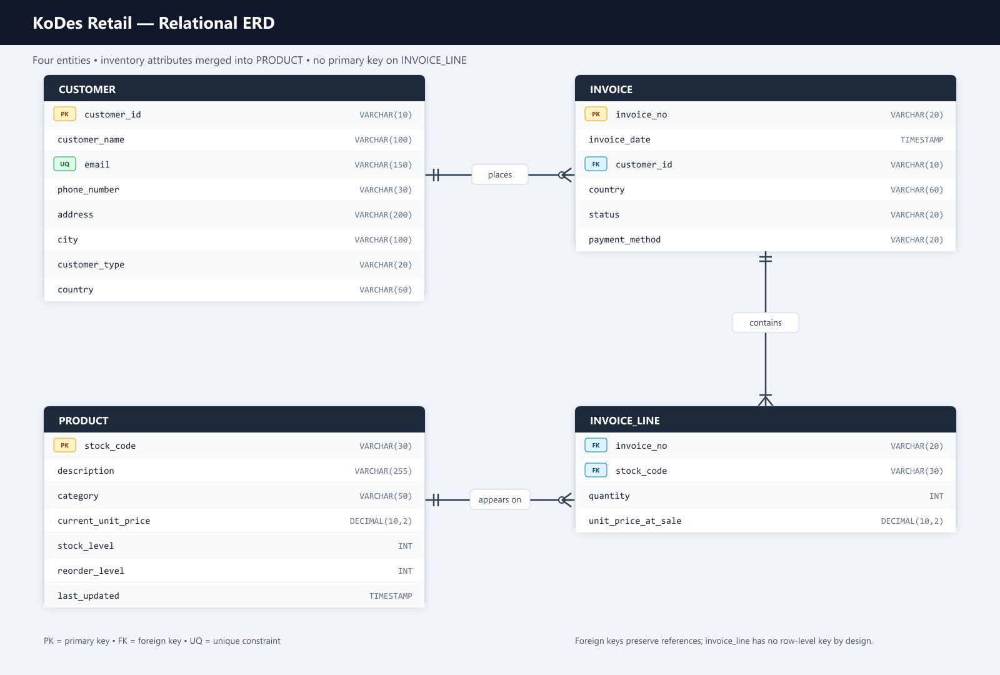
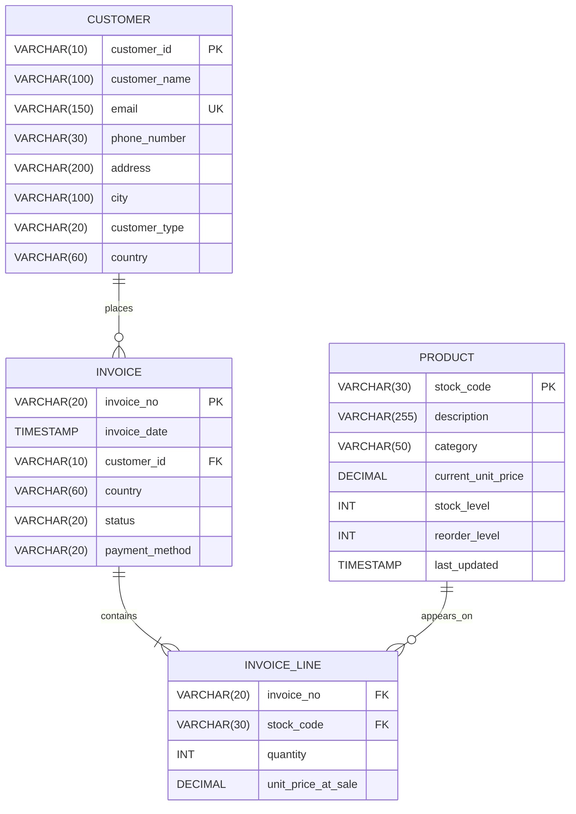

# KoDes Retail Master Documentation

## Purpose and Authority

This document applies the ZIP documentation as the data and analysis baseline, together with the lecturer's later design directions recorded in this project conversation: merge stock attributes into `product` and do not define a primary key or `line_id` on `invoice_line`. The assignment brief is retained as context, but those lecturer directions govern these two schema decisions.

The source CSV contains eight fields: `Invoice`, `StockCode`, `Description`, `Quantity`, `InvoiceDate`, `Price`, `Customer ID`, and `Country`. Added customer profile, inventory, payment, and category fields are synthetic or derived and are identified below.

## 1. Source Findings and Row Reconciliation

The complete source contains 1,067,371 rows from 1 December 2009 through 9 December 2011. An earlier single-sheet Excel export was truncated at 1,048,575 rows. Exact deduplication removed 34,335 rows, leaving the current input `data/raw/online_retail_data_dedup.csv` with 1,033,036 rows.

| Pipeline stage | Rows |
|:---|---:|
| Complete source | 1,067,371 |
| Exact duplicates removed | 34,335 |
| Deduplicated input | 1,033,036 |
| Admin SKU and blank-description union removed | 10,061 |
| Final invoice-line rows | 1,022,975 |
| Total removed from complete source | 44,396 (4.16%) |

The exclusion union includes 5,823 admin-code rows and 4,275 blank-description rows, with 37 rows overlapping. Anonymous rows from every country are retained. The current product-code policy retains `DCGS*` merchandise and uses exact matching for the administrative codes plus the `GIFT_0001_` prefix.

## 2. Corrections and Derived Data

- Invoice dates are standardized to the earliest observed date per invoice (83 invoices had multiple timestamps).
- Product descriptions are normalized and selected by mode for each SKU. Descriptions on genuine priced product lines inform the catalog; 18 SKUs with no genuine sale description use `UNLISTED RETAIL ITEM`.
- 709 zero-price genuine product rows receive the mean positive price for their SKU. 254 unrecoverable zero-price staff-note rows remain at zero and are classified as `Loss`.
- C-prefixed invoice lines are `Cancelled`; non-C negative-quantity lines and unrecoverable zero-price lines are `Loss`; other positive-quantity lines are `Completed`. Invoice header status is chosen by the modal line status. Quantities are stored as absolute values.
- Anonymous transactions from 15 countries map to one Guest customer ID `0` (4,036 invoices and 228,752 rows). `invoice.country` preserves the transaction's country; Guest's profile country is only a label.
- Registered customers with multiple recorded countries receive their modal country in `customer.country`; each invoice keeps the transaction country.
- Contact fields (`customer_name`, `email`, `phone_number`, `address`, `city`) and `payment_method` are synthetic, deterministic placeholders. They are not source data or verified personal/payment information.
- `product.category` is assigned by description keyword rules. `product.current_unit_price` is the median positive historical price per SKU in this processed dataset, a reference proxy rather than an observed live catalog price. `invoice_line.unit_price_at_sale` stores the actual transaction price, including any discount, independently; changing the product reference price does not rewrite sale history.
- `product.stock_level` begins at an assumed 1,000 for each SKU. `reorder_level` estimates about two weeks of demand, rounded to tens and bounded from 20 to 500. `last_updated` records processing time. These fields do not reconstruct historic warehouse balances.

## 3. Current ERD

The current model has four entities. Stock attributes are merged into `product`; the separate inventory entity and one-to-one relationship are removed. `invoice_line` is the associative table between invoice and product and has no primary key, per lecturer direction.

Editable vector: [erd.svg](erd.svg). The physical table definitions are in [`../sql/schema.sql`](../sql/schema.sql), and automation routines are in [`../sql/advanced.sql`](../sql/advanced.sql).

### Entity counts and key design

| Table | Rows | Key design |
|:---|---:|:---|
| `customer` | 5,877 | PK `customer_id` |
| `product` | 4,755 | PK `stock_code`; includes inventory fields |
| `invoice` | 47,915 | PK `invoice_no`; FK `customer_id` |
| `invoice_line` | 1,022,975 | No PK; FKs `invoice_no`, `stock_code` |

The source can repeat `(Invoice, StockCode)`, so that pair is not unique. By lecturer direction no surrogate line key is introduced. Consequently exact duplicate invoice-line rows cannot be uniquely addressed; the schema enforces the foreign keys but no uniqueness rule on detail rows.

## 4. Query and Automation Notes

Query 2 performs an `UPDATE` to set the invoice status to `Cancelled` and keeps the invoice and detail rows. The optional cancellation trigger restores stock in `product.stock_level`. This retains the transaction records but does not separately record the previous invoice status.

The inventory trigger updates the stock fields on `product`; the `GetCustomerInvoiceHistory` function counts the non-null `invoice_no` foreign key on the left-joined detail rows, since `invoice_line` has no row identifier. The RFM view calculates completed-invoice summaries when queried.

## 5. Processed Results in ZIP Reference

Invoice header status counts: 39,544 `Completed`, 7,405 `Cancelled`, 966 `Loss`.

- Query 3: United Kingdom revenue 17,716,602.07 across 36,210 completed invoices; EIRE 624,259.93 across 581; Netherlands 550,803.81 across 217.
- Query 4: 1,163 registered customers exceed the mean registered-customer spend of 2,918.47. Top spenders include `18102` (580,987.04) and `14646` (527,781.92).
- Query 5: 1,505 products satisfy the Germany exclusion and two-country minimum. `21888` and `21912` each appear in 19 countries outside Germany.

Values are shown in the source dataset's currency units; no currency conversion is applied.

## 6. Known Technical Trade-off

The no-primary-key rule on `invoice_line` is followed as directed. It differs from the assignment brief's general instruction that every table have a primary key. It also means the database cannot uniquely identify or update/delete one of two otherwise identical detail rows. The current query/reporting design uses aggregate operations and the two foreign keys, and does not rely on a line ID.
